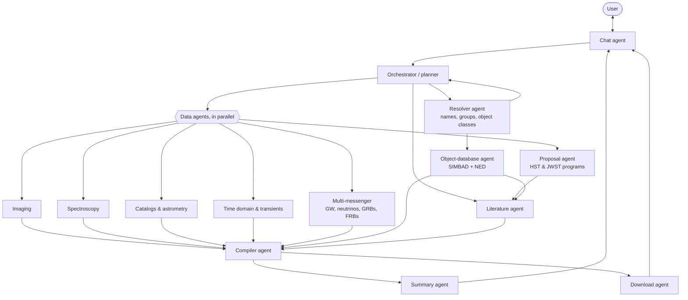

# SCOOP

**S**ky **C**one **O**f **O**bservations and **P**apers

> Point at a patch of sky. Get back everything.

SCOOP is a tool for querying a region of the sky and getting back *all* of the
data that exists there — imaging, spectra, catalogs, time-domain alerts,
multi-messenger localizations — together with the literature written about it
and a plain-language summary of what is known. Data comes back ready to
download, not just as links to other portals.

You can ask in plain language. "NGC 300", "the Sculptor Group", "QSOs within 1
degree of the center of M31" or "papers discussing internal velocities of Local
Group dwarf spheroidals" all work as queries.

The name is a nod to the Virtual Observatory **cone search** (a position plus a
radius), which is what SCOOP does at its core, just across every archive at
once. And "scoop" also means *the news on something*, which is the
literature-and-summary half of the tool.

> **A note on the name:** SCOOP is *not* about "scooping" other people's
> research. It's about getting the latest scoop: staying up to date on what is
> known and what is being done in a patch of sky. Showing who is already
> working on a source (through papers, proposals and telegrams) is meant to
> help people find related work and collaborators, and to credit that work.

> **Status:** early development. Core data models and an optional LangGraph
> chat/tool-loop scaffold are implemented, alongside a fixture-backed SvelteKit
> workspace sketch. Live archive tools and the end-user Python/CLI examples below
> remain planned. Start with the [web workspace](docs/web_workspace.md),
> [LangGraph chat layout](docs/langgraph_chat.md), and
> [core data model](docs/core_data_model.md).

SCOOP is being built as part of the
[Schmidt Agentic AI in Science workshop](https://ai-for-science.org/) hosted by
the University of Toronto. In keeping with the workshop's theme, SCOOP is
designed as a team of cooperating AI agents, each responsible for one part of
the job (see [Agent architecture](#agent-architecture)).

---

## Why

Today, answering "what do we know about this bit of sky?" means visiting a dozen
portals (MAST, IRSA, HEASARC, ESA archives, SDSS, SIMBAD/NED, ADS, GraceDB, …),
each with its own query syntax, coordinate conventions and output formats, and
then reading the papers yourself. SCOOP does that fan-out for you and hands back
one organized result.

## Inspiration: Aladin

SCOOP owes a lot to [Aladin](https://aladin.cds.unistra.fr/#Information), the
interactive sky atlas from CDS Strasbourg. Aladin lets you browse any patch of
sky across many surveys (HiPS) and overlay SIMBAD, VizieR and other catalogs
on the image. That "everything about this patch of sky in one view" experience
is the starting point for SCOOP.

SCOOP aims to go further in a few directions:

- **More archives in one query.** Pointed-observation archives such as MAST
  (HST, JWST, TESS, GALEX and others), IRSA, HEASARC, ESA and the spectroscopic
  surveys, alongside the survey imaging and catalogs Aladin already shows.
- **Spectra.** Spectra are first-class results, not just catalog rows.
- **Direct download.** Images, spectra and tables can be downloaded straight
  from the result, individually or in bulk.
- **Natural-language queries.** Ask for objects, groups, classes of sources or
  science topics in plain language rather than typing coordinates.
- **Literature and summaries.** Relevant papers come back with the data, along
  with a cited summary of what they say.

If you use Aladin, CDS asks for the acknowledgement *"This research has made
use of 'Aladin sky atlas' developed at CDS, Strasbourg Observatory, France"*
and the references below, as listed on the
[Aladin site](https://aladin.cds.unistra.fr/aladin.gml):

- Aladin Desktop: Bonnarel, F., Fernique, P., Bienaymé, O., et al. 2000,
  "The ALADIN interactive sky atlas", A&AS, 143, 33
  ([2000A&AS..143...33B](https://ui.adsabs.harvard.edu/abs/2000A%26AS..143...33B))
- Aladin Lite (v2): Boch, T. & Fernique, P. 2014, "Aladin Lite: Embed your
  Sky in the Browser", ASP Conf. Ser. 485, ADASS XXIII, 277
  ([2014ASPC..485..277B](https://ui.adsabs.harvard.edu/abs/2014ASPC..485..277B))
- Aladin Lite (v3): Baumann, M., Boch, T., Pineau, F.-X., et al. 2022,
  "Aladin Lite v3: Behind the Scenes of a Major Overhaul", ASP Conf. Ser. 532,
  ADASS XXX, 7
  ([2022ASPC..532....7B](https://ui.adsabs.harvard.edu/abs/2022ASPC..532....7B))

## Example queries

| You ask | SCOOP returns |
| --- | --- |
| `NGC 300` | Imaging, spectra and catalog entries for the galaxy, plus the papers about it |
| `Sculptor Group` | The group's members, with data and literature for each |
| `QSOs within 1 degree radius of the center of M31` | Spectroscopically confirmed quasars in that cone, with their spectra |
| `Milky Way satellites near the edge of the Local Group` | Distant MW satellite galaxies selected by distance and type, with data for each |
| `papers discussing internal velocities / proper motions of Local Group dwarf spheroidals` | A ranked reading list with a summary of the main results and open questions |

Not every question is a cone. "Satellites near the edge of the Local Group" is
a selection by object type and distance, and a topic question may have no
sky position at all. SCOOP turns each request into the right mix of name
resolution, cone or region searches, catalog selections and literature
searches.

## What it does

Given a query (a natural-language request, an object or group name, or
coordinates and a radius), SCOOP:

0. **Interprets the request** – an LLM parses natural language into a
   structured plan: targets, regions, object classes, constraints (distance,
   redshift, magnitude) and literature topics. The plan is shown to the user
   so they can check or edit it.
1. **Resolves the target** – name → coordinates via Sesame/SIMBAD/NED, and
   collects known objects inside the cone with their identifiers and types.
   Group or class queries ("Sculptor Group", "QSOs") become lists of member
   objects.
2. **Merges what SIMBAD and NED know** – for each object, combines the two
   databases into a single object profile: identifiers, classifications,
   positions, redshifts and velocities, distances, photometry and their
   bibliographies, with any disagreements between them flagged.
3. **Queries the archives** – observations, images, spectra and catalog
   entries overlapping the cone, from as many facilities as possible.
4. **Checks multi-messenger and transient coverage** – whether the position
   falls inside gravitational-wave, neutrino, GRB or FRB localization regions,
   and which transient alerts have been reported nearby.
5. **Gathers the literature** – papers that mention objects in the region, or
   that address the requested topic, via ADS and arXiv. "Literature" here also
   covers **observing proposals** (HST, JWST, Chandra, ALMA and other
   facilities), whether or not the observations have happened yet, and
   **Astronomer's Telegrams (ATels)** and GCN Circulars for transients.
6. **Summarizes** – an LLM-written digest of the region or topic: what's there,
   what has observed it, what's been published, and what's notable or open.
7. **Downloads** – fetches the selected images, spectra and tables to disk,
   with a manifest recording where each file came from.
8. **Chats** – follow-up questions ("only JWST", "which of these have
   spectra?", "what do the papers say about the distance?") refine the result
   instead of starting over.

## Planned data coverage

| Domain | Examples |
| --- | --- |
| Space-based UV/optical/IR | HST, JWST, Spitzer, GALEX, Euclid, TESS, Kepler/K2 (MAST, IRSA, ESA) |
| Ground-based imaging surveys | SDSS, Pan-STARRS, DES/DECaLS (Legacy Surveys), 2MASS, UKIDSS, VISTA |
| Spectroscopy | SDSS/BOSS/APOGEE, DESI, LAMOST, Gaia RVS/XP, archival HST/JWST spectra |
| Astrometry & catalogs | Gaia, WISE/unWISE, VizieR catalogs |
| QSO catalogs | Gaia DR3 QSO candidates, Gaia-CRF3, Quaia, MILLIQUAS (with its per-object references), SDSS DR16Q |
| X-ray & gamma-ray | Chandra, XMM-Newton, Swift, eROSITA, Fermi (HEASARC, ESA) |
| Radio & (sub)mm | VLASS, FIRST, NVSS, LOFAR, ALMA, Planck |
| Time domain | ZTF, ATLAS, Gaia alerts, TNS transient reports |
| Multi-messenger | LIGO/Virgo/KAGRA GW sky maps (GraceDB), IceCube neutrinos, GCN GRB localizations, CHIME FRBs |
| Object databases | SIMBAD, NED (merged into one profile per object), Local Volume Database (always checked for nearby dwarf galaxies and star clusters) |
| Literature | NASA ADS, arXiv, observing proposals (HST, JWST, Chandra, ALMA, …), Astronomer's Telegrams, GCN Circulars |

Coverage will grow incrementally; each source is implemented as a pluggable
module so new archives can be added without touching the core.

## Installation

SCOOP targets Python 3.11+. The core has no runtime dependencies. Install the
optional LangGraph chat layer from the repository root with:

```bash
pip install -e '.[chat]'
```

Supply a tool-calling model and application tools; no provider or live archive
connection is configured by this extra. See the
[chat layout and invocation example](docs/langgraph_chat.md).

For the broader astronomy workshop environment, `requirements.txt` pins the
packages from the original development environment:

```bash
conda create -n scoop python=3.11
conda activate scoop
pip install -r requirements.txt
```

To try the data side, run a smoke test: it queries HST/JWST imaging, Gaia,
QSOs and spectra around a nearby galaxy. See
[smoke_tests/README.md](smoke_tests/README.md):

```bash
python smoke_tests/lvdb_field.py --out out/draco --serve
```

## Web workspace

The SvelteKit frontend lives in [`web/`](web/README.md): an Aladin Lite sky map
with layer, chat and results panels sharing one selection context. The Python
API server streams agent turns to it and serves ADS searches:

```bash
pip install -e '.[server]'
python -m scoop.server          # 127.0.0.1:8787; model and keys: ⚙ Settings tab or env vars
cd web && npm ci && npm run dev -- --host 127.0.0.1
```

The agent can also run its own Python (`run_python`): numpy, pandas, scipy, astropy,
matplotlib and scikit-learn in Pyodide (Python in WebAssembly), with the field's
tables and no network or file access. It needs macOS and Node; set it up once with
`cd sandbox && npm ci && npm run setup` (about 70 MB). See [`scoop/sandbox.py`](scoop/sandbox.py).

See the [workspace architecture](docs/web_workspace.md), the
[map and agent interaction design](docs/map_interaction.md), the
[shared ADS service](docs/ads_service.md), and the
[changes made to teammates' code](docs/changes_to_team_code.md).

## Dataset scout

SCOOP's coverage decays: surveys release data, releases supersede the ones the
skills are pinned to, and nobody notices until SCOOP quietly answers from a
four-year-old catalogue. The **dataset scout** is a scheduled agent that looks
for that decay once a month.

It harvests data-release and catalogue papers from ADS (which indexes arXiv too)
for the window since the last scan, compares them against what the skills and
the registered data sources already cover, and for each real gap verifies the
dataset against the archive's own pages and writes:

- a draft skill in [`skills/surveys/`](skills/index.md), in the template from
  [`new_survey_skill`](skills/meta/new_survey_skill.md);
- a registered module in [`scoop/sources/`](scoop/sources/__init__.py), which is
  all the field pipeline needs to start returning the survey's rows;
- a probe in `smoke_tests/` that re-checks the facts;
- a dated report in `docs/scout/` that becomes the pull-request body.

Everything is written as `status: draft`; the
[workflow](.github/workflows/dataset-scout.yml) only ever pushes a branch, so
nothing is trusted until a person reviews it.

```bash
pip install -e '.[scout]'
ADS_API_TOKEN=... python -m scoop.scout --dry-run        # harvest and report; no model, no writes
ADS_API_TOKEN=... ANTHROPIC_API_KEY=... python -m scoop.scout --max-proposals 2
```

Design and limits: [docs/dataset_scout.md](docs/dataset_scout.md). Running and
reviewing a scan: [skills/meta/dataset_scout.md](skills/meta/dataset_scout.md).

## Planned usage

```python
from scoop import scoop

result = scoop("M87", radius="2 arcmin")

result.objects        # known sources, with merged SIMBAD + NED profiles
result.observations   # observation records, grouped by facility
result.spectra        # spectra with download links
result.images         # image cutouts / previews
result.localizations  # GW / neutrino / GRB / FRB regions containing the position
result.papers         # ADS/arXiv records, ranked by relevance
result.proposals      # observing programs targeting the region, incl. not-yet-executed ones
result.telegrams      # ATels / GCN Circulars about transients in the region
print(result.summary) # natural-language digest

result.download("m87_data/", kinds=["spectra", "images"])  # fetch the files

# Natural-language queries and follow-ups
qsos = scoop.ask("QSOs within 1 degree radius of the center of M31")
qsos = qsos.refine("only those with SDSS or DESI spectra")
```

And from the command line:

```bash
scoop "187.7059 +12.3911" --radius 2arcmin --out m87_scoop/ --download
scoop chat   # interactive session
```

## Agent architecture

The initial implementation is a **LangGraph chat agent with typed tools**:
`START → agent → tools → agent → END`, or a direct answer/clarification when no
tool call is needed. Conversation messages and tool-published result snapshots
are checkpointed separately; archive access stays in deterministic tools and
data-source modules. See the [implemented layout](docs/langgraph_chat.md).

The specialized-agent diagram below is a longer-term sketch, not the current
runtime. We will add separate agent roles only when a concrete workflow needs
them, rather than requiring a planner/compiler pipeline for every chat turn.



| Agent | Job |
| --- | --- |
| **Chat agent** | Talks with the user, shows the query plan for approval, and handles follow-ups ("only JWST", "which have spectra?") by updating the plan instead of starting over. |
| **Orchestrator / planner** | Turns the request into a structured plan (targets, regions, object classes, constraints, literature topics), sends tasks to the other agents, and tracks what has come back. |
| **Resolver agent** | Turns names, groups and object classes into concrete targets: "Sculptor Group" into member galaxies, "QSOs near M31" into a catalog selection, and so on (Sesame, SIMBAD, NED, VizieR). |
| **Object-database agent** | Pulls everything SIMBAD and NED hold on each object and merges it into one profile: all identifiers and aliases, object types, positions, redshifts and velocities, distances (including NED's redshift-independent distances), photometry and SEDs, sizes and morphology, and notes. SIMBAD is strongest for stars and Galactic objects and NED for extragalactic ones, so between them they cover most targets. Every value keeps its source, and where the two databases disagree both values are kept and the difference flagged. Each database's bibliography for the object is passed to the literature agent. |
| **Data agents** | One agent per kind of data, each knowing the archives and protocols for its area: **imaging**, **spectroscopy**, **catalogs & astrometry**, **time domain & transients**, and **multi-messenger** (GW sky maps, neutrinos, GRBs, FRBs). Within these, agents can be split further by wavelength regime: radio/(sub)mm, IR, optical, UV, X-ray and gamma-ray. |
| **Proposal agent** | Takes the HST and JWST programs behind the observations found (including planned, not-yet-executed JWST observations), fetches their public program pages and proposal abstracts, and summarizes the science that motivated each program, its status, and what came of it. Groups programs by science theme and flags what is still to come. |
| **Literature agent** | Finds papers on the targets or the requested topic in ADS and arXiv, ranks them by relevance, and pulls out the key results. Also finds **observing proposals** that target the objects or region (HST, JWST, Chandra, ALMA and others), including approved programs whose observations haven't been taken yet, and **Astronomer's Telegrams** and GCN Circulars for transient sources. |
| **Compiler agent** | Collects everything the data agents found, puts it into a common schema, cross-matches sources between surveys, removes duplicates, and builds the final inventory of what exists. |
| **Summary agent** | Writes the plain-language digest of the data and the literature, with every claim cited to a paper or dataset. |
| **Download agent** | Fetches the images, spectra and tables the user selects, with caching and a manifest of where each file came from. |

One agent is not in that diagram because it does not serve a request: the
**dataset scout** runs once a month, finds datasets SCOOP is missing or has gone
stale on, and opens a pull request with draft skills and data sources for a
person to review. See [Dataset scout](#dataset-scout) below.

Each agent works from **skills**: short guides to what each archive holds,
how to check coverage and cost before downloading, how to query it, its
gotchas, the default decisions the agent makes, and how it explains them to
the user (e.g. "Skipping Gaia RVS spectra: they only exist for bright stars,
and the members of this galaxy are much fainter. Say 'include Gaia RVS' to
override."). See [skills/index.md](skills/index.md).

Splitting the work this way means:

- **Agents run in parallel**, so a slow archive doesn't hold up the others.
- **Each agent stays focused.** It needs only the instructions and tools for
  its own area, which keeps prompts short and behavior predictable.
- **New sources are easy to add.** Covering a new archive or regime means
  adding or extending one data agent.
- **Failures stay contained.** If one agent fails, the result reports that
  gap and still includes everything else.

## Design sketch

- **Cone in, everything out.** A single query object (center + radius, or an
  arbitrary region/MOC) is passed to every source module.
- **Source modules** wrap existing tools — [`astroquery`](https://astroquery.readthedocs.io),
  [`pyvo`](https://pyvo.readthedocs.io) (TAP / SIA / SSA / cone search),
  [`mocpy`](https://cds-astro.github.io/mocpy/) and HEALPix for localization
  maps — and return results in a common schema.
- **Parallel, fault-tolerant fan-out.** Archives are queried concurrently; a
  slow or failing archive is reported, not fatal.
- **Common outputs.** Astropy tables and a structured result object, exportable
  to JSON/VOTable/FITS, plus an optional HTML report.
- **Literature + summary layer.** Papers are retrieved from ADS/arXiv for the
  objects found, then an LLM agent reads abstracts (and observation metadata)
  to write a cited summary. Every claim in the summary links back to a paper or
  dataset.
- **Proposals count as literature.** A proposal abstract says what a team
  thinks is interesting about a source and what they plan to do, which is
  valuable even before any data exist. Approved but unexecuted programs also
  show what data is coming, and who to talk to about it.
- **Telegrams for transients.** ATels and GCN Circulars are often the first,
  and sometimes only, report on a transient. They are collected alongside the
  papers and time-domain data for any transient in the region.
- **Natural-language front end.** An LLM turns the user's request into a
  structured query plan and calls the source modules as tools. It never
  invents data: every object, dataset and paper in a result comes from an
  archive query.
- **Downloads.** Each result keeps the access URL (DataLink, SIA/SSA, archive
  APIs) for its products, so files can be fetched on demand, with caching.

## Roadmap

- [x] Initial query and result models ([scope and limitations](docs/core_data_model.md))
- [ ] Orchestrator and a shared message format for passing tasks and results between agents
- [ ] Natural-language query parsing into structured query plans
- [ ] Group, class and constraint queries (e.g. members of a group, QSOs in a region)
- [ ] Name resolution and SIMBAD/NED object lists
- [ ] Merged SIMBAD + NED object profiles, with provenance and conflict flags
- [ ] MAST (HST, JWST, TESS, GALEX) observations and spectra
- [ ] IRSA, HEASARC and ESA archive modules
- [ ] SDSS / DESI / LAMOST spectra
- [ ] GW sky-map containment checks (GraceDB) and other multi-messenger alerts
- [ ] ADS / arXiv literature retrieval
- [ ] LLM-generated, citation-backed summaries
- [ ] Topic-based literature search and summaries
- [ ] Observing proposals (HST, JWST, Chandra, ALMA, …), including not-yet-executed programs
- [ ] Astronomer's Telegrams and GCN Circulars for transients
- [ ] Direct download of images, spectra and tables
- [ ] Chat interface with follow-up refinement
- [ ] Aladin Lite sky view in the HTML report
- [ ] CLI and HTML report
- [ ] Caching and rate-limit handling
- [x] Monthly dataset scout: find missing or superseded datasets and draft the
      skill, data source and probe for each ([docs](docs/dataset_scout.md))

## Contributing

Ideas, issues and new source modules are welcome. If there's an archive you'd
want SCOOP to cover, open an issue.


## Team and workstreams

- **Radha Mastandrea** — agent orchestration, safety/budget controls, and evaluation metrics.
- **Kevin McKinnon** — astrometry, Local Volume structures, and imaging inventory.
- **Duo Xu** — deterministic evaluation and benchmarking.
- **Xuan Ji** — exoplanet-host agent.

Detailed work plans:
- [plans/kevin_mckinnon.md](plans/kevin_mckinnon.md)
- [plans/duo_xu.md](plans/duo_xu.md)
- [plans/xuanji.md](plans/xuanji.md)

## Duo's plan

Duo Xu is working on **evaluation and benchmarking**: checking that every
object, dataset, file and paper SCOOP returns is real (it exists in the archive
it came from), lies in the requested field of view, is complete (nothing the
archives hold is silently missing) and has correct values. This includes a
benchmark set of test queries and a scorecard. Agents need to attach
provenance (archive, native ID, query, access URL) to every record for these
checks to work. Full plan: [plans/duo_xu.md](plans/duo_xu.md).

(Data reduction and cross-matching, the original plan, were dropped to keep
the two-day workshop focused on data gathering.)

## Kevin's plan

Kevin McKinnon is working on **astrometry and Local Volume structures**: Gaia
sources and proper motions, proper motions of dwarf galaxies, globular
clusters and streams, checking the Local Volume Database on every query, QSO
catalogs and their references, an inventory of HST/JWST imaging (depth,
estimated precision, epochs and time baselines), and toggleable sky overlays
of nearby structures. Full plan:
[plans/kevin_mckinnon.md](plans/kevin_mckinnon.md).

## Natural-language layer (shared)

Several team members are working on the **natural-language layer**: the
LangGraph chat agent (the default framework; see [Agent architecture](#agent-architecture))
answering requests like "display data within 2 degrees of the GD-1 spur
feature" by calling the data tools, and asking the user when a request is
ambiguous or expensive. It includes a proper-motion agent. Shared plan:
[plans/natural_language_queries.md](plans/natural_language_queries.md).

## Auto-calibrated cost checking (default command path)

Use the runner below to execute commands through budget checking and automatic
estimate calibration every run.

```bash
python3 scripts/auto_calibrated_runner.py "Summarize this abstract" --model gpt-4 --budget-usd 0.05 --output-tokens 300
```

The runner returns both:
- budget decision details
- calibration feedback (estimate vs derived actual)

## Yilun's idea
- [ ] orchastration of literature, data agents.


## Xuan's idea

- [ ] locate the exoplanet hosts??
