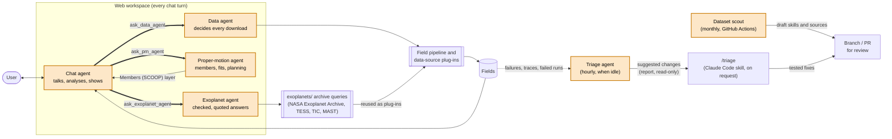
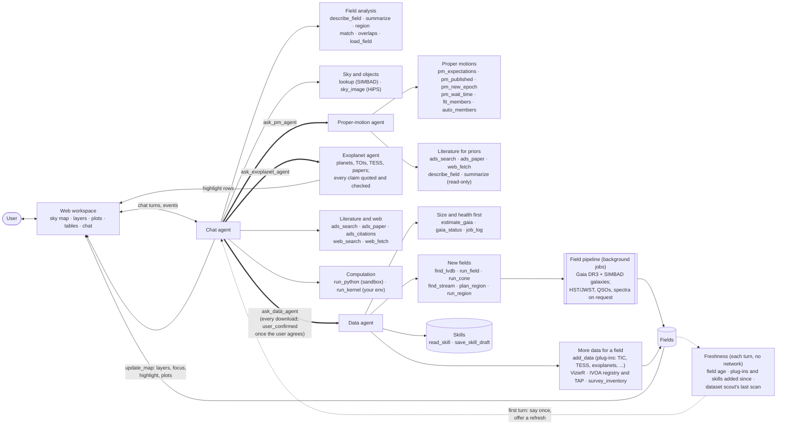
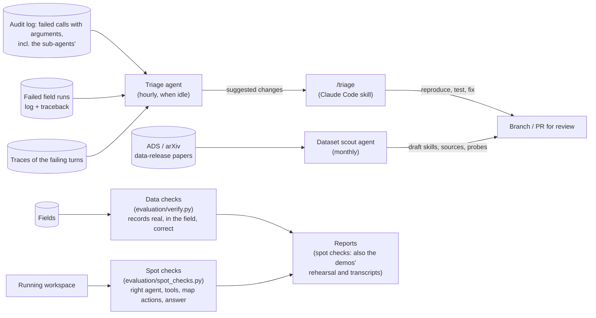

# SCOOP


**S**ky **C**one **O**f **O**bservations and **P**apers

> Point at a patch of sky. Get back everything.

The mark is a cone search — an apex at the observer opening onto one patch of
sky — which, read the other way, is a scoop. Files and usage:
[`assets/README.md`](assets/README.md).

SCOOP is a tool for exploring a patch of sky: point it at an object, a cone, a box or a
stellar stream and it gathers what the archives hold there (Gaia astrometry, HST/JWST
observations, QSO catalogs, SDSS/DESI spectra, galaxies from SIMBAD, survey catalogs
from VizieR and any TAP service), puts it on an interactive sky map, and answers
questions about it with the literature alongside. You ask in plain language in a web
workspace; a team of agents decides what to fetch (sizing every request first),
analyses it, shows the answer on the map and cites where every number came from.

The name is a nod to the Virtual Observatory **cone search** (a position plus a
radius), which is what SCOOP does at its core, just across every archive at
once. And "scoop" also means *the news on something*, which is the
literature-and-summary half of the tool.

> **A note on the name:** SCOOP is *not* about "scooping" other people's
> research. It's about getting the latest scoop: staying up to date on what is
> known and what is being done in a patch of sky. Showing who is already
> working on a source (through papers, proposals and telegrams) is meant to
> help people find related work and collaborators, and to credit that work.

> **Status:** working prototype, built over a two-day workshop. The web workspace,
> its agents, the field pipeline and the evaluation run today (see
> [What you can do today](#what-you-can-do-today)); parts of the original vision, such
> as a Python API, a command-line tool, NED profiles, X-ray/radio archives and
> multi-messenger localizations, are still planned.

SCOOP is being built as part of the
[Schmidt Agentic AI in Science workshop](https://ai-for-science.org/) hosted by
the University of Toronto. In keeping with the workshop's theme, SCOOP is
designed as a team of cooperating AI agents, each responsible for one part of
the job (see [Agent architecture](#agent-architecture)).

---

## Quick start: the web workspace

The easiest way to use SCOOP is the web workspace: a Python server and a web page you
talk to. Tested from a fresh clone (Python 3.12, Node 25, macOS):

```bash
git clone https://github.com/KevinMcK95/scoop.git && cd scoop
python3 -m venv .venv && source .venv/bin/activate      # Python 3.11+
pip install -e '.[server]'                                # the server, its agents and the field pipeline
python -m scoop.server                                    # API on http://127.0.0.1:8787
```

In a second terminal (Node 24+):

```bash
cd web && npm ci && npm run dev -- --host 127.0.0.1      # the workspace on http://127.0.0.1:5173
```

Open <http://127.0.0.1:5173>, then in ⚙ **Settings** give SCOOP a model and, for the
literature, an ADS token:

- **Model:** any OpenAI-compatible endpoint that supports tool calls (base URL, model
  name and API key; OpenRouter works). Or set `SCOOP_MODEL`, `SCOOP_MODEL_BASE_URL` and
  `SCOOP_MODEL_API_KEY` before starting the server.
- **ADS token:** from <https://ui.adsabs.harvard.edu/user/settings/token> (or
  `ADS_API_TOKEN`).

Settings are kept in `~/.config/scoop/settings.json` (owner-only), never in the repository.

Then ask, for example: *"Show me the Draco dwarf galaxy"*. The data agent sizes the
request, builds the field in the background (a minute or two the first time; the Local
Volume Database is downloaded once) and the map loads it. Follow with *"can you do a bulk
proper motion measurement for draco? population fitting after identifying likely
members?"*. More in [docs/demos.md](docs/demos.md).

Optional extras: `run_python` (sandboxed Python for the agent, macOS + Node: `cd
scoop/runtime/sandbox && npm ci && npm run setup`) and `run_kernel` (your own Jupyter environment); see
[More about the workspace](#more-about-the-workspace).

## What you can do today

| Ask or do | What happens |
| --- | --- |
| *"Show me the Draco dwarf galaxy"*, *"Gaia stars within 8′ of TRAPPIST-1"* | The data agent sizes the request (Gaia counts in about a second), starts a field (Gaia DR3 and SIMBAD galaxies by default; HST/JWST observations, QSO catalogs and SDSS/DESI spectra on request or for Local Volume Database objects) and the map loads it. |
| *"A 0.5 deg² box around COSMOS"*, *"Gaia data along GD-1 within 10° of the spur"* | Regions beyond cones: boxes, polygons, and bands along stellar-stream tracks (galstreams, or a track from a paper), with proper-motion cuts in the stream's own frame, proposed for you to confirm. |
| *"A degree around Sgr A\*"* | Too big to start without asking: the size and the options come back first. |
| *"Which trusted QSOs fall inside HST or JWST images here?"* | Field analysis: catalogs matched against observation footprints, highlighted on the map with their epochs and time baselines. |
| *"Measure the bulk proper motion from likely members"*, lasso stars on the CMD and *"fit my members"* | The proper-motion agent selects members itself or fits yours, and compares the bulk motion and dispersion with the literature; it also plans what a new HST/JWST epoch would give. |
| *"Show the RV distribution of Leo II's stars"*, *"add LAMOST spectra here"* | More data from VizieR and TAP services; velocities and [Fe/H] reach the field's stars and plots. |
| *"How many planets does TRAPPIST-1 have?"* | The exoplanet agent's answer, every claim quoted from its source and checked. |
| *"Recent papers on Draco's star-formation history"* | ADS search; bibcodes become links. |

Everything the agents report comes from a tool result; the pipeline records each of its
decisions (what it kept, skipped and why) and the workspace shows them.

## Why

Today, answering "what do we know about this bit of sky?" means visiting a dozen
portals (MAST, IRSA, HEASARC, ESA archives, SDSS, SIMBAD/NED, ADS, GraceDB, …),
each with its own query syntax, coordinate conventions and output formats, and
then reading the papers yourself. SCOOP does that fan-out for you and hands back
one organized result.

## Agent architecture

### What runs today

SCOOP has **six agents** (a model working in a loop with tools). Four serve the
workspace, the triage agent runs in the workspace server on a timer, and the dataset
scout runs on its own. Everything else (the field pipeline, data-source
plug-ins, budgets, Gaia sizing and health checks, evaluation) is ordinary code the
agents call or that checks them.



| Agent | Runs | Built on | Started by |
| --- | --- | --- | --- |
| **Chat agent** | in the workspace | LangGraph ([`scoop/agents/graph.py`](scoop/agents/graph.py)) | every user message |
| **Data agent** | in the workspace, inside a chat turn | LangGraph, its own prompt and tools ([`scoop/agents/data_agent.py`](scoop/agents/data_agent.py)) | the chat agent's `ask_data_agent` |
| **Proper-motion agent** | in the workspace, inside a chat turn | LangGraph, its own prompt and tools ([`scoop/agents/pm_agent.py`](scoop/agents/pm_agent.py)) | the chat agent's `ask_pm_agent` |
| **Exoplanet agent** | in the workspace, inside a chat turn (also standalone) | LangGraph, answers checked in code ([`scoop/exoplanets/agent.py`](scoop/exoplanets/agent.py), chat tool [`scoop/agents/exoplanet_agent.py`](scoop/agents/exoplanet_agent.py)) | the chat agent's `ask_exoplanet_agent`; Python, its benchmark |
| **Triage agent** | in the workspace server, on a timer | LangGraph ([`scoop/agents/triage_agent.py`](scoop/agents/triage_agent.py)) | at most hourly (`--triage-every`), after 10 idle minutes, when there are new failures |
| **Dataset scout** | GitHub Actions, monthly | a LangChain model in a budgeted loop ([`scoop/scout/`](scoop/scout/__main__.py)) | schedule, or by hand |

No agent changes SCOOP's code: the data agent reads failed runs and reports them during
a turn; the triage agent reads new failures, the traces of the turns they happened in
and the source (read-only) and writes suggested changes, each with its cause (file and
line), a sketch of the fix and a test (reports beside the traces, listed at
`/api/triage`); `/triage` in Claude Code turns accepted suggestions into tested fixes.

#### The workspace agents

The chat agent, the data agent and the proper-motion agent are LangGraph agents with
typed tools (`START → agent → tools → agent → END`; [`scoop/agents/graph.py`](scoop/agents/graph.py)).
The **chat agent** talks to the user and works on the loaded field; the **data agent**
decides everything that is downloaded; the **proper-motion agent** selects members and
measures and plans proper motions. These two run inside the chat agent's turn
([`scoop/agents/subagent.py`](scoop/agents/subagent.py)): what they show reaches the map,
and their failed calls reach the audit log. The **exoplanet agent** (on the same chat model) is
handed exoplanet questions the same way, through `ask_exoplanet_agent`. Archive access stays in deterministic tools,
the field pipeline and data-source modules; the agents choose and explain, they never
invent data.



| Agent | What it does |
| --- | --- |
| **Chat agent** ([prompt](scoop/agents/prompt.py)) | Answers from the loaded field and shows the answer on the map: layers, highlights, plots (CMD, proper motions, RVs), annotations. Analyses what is there (counts, statistics, overlaps and time baselines of HST/JWST footprints, cross-matches), reads the literature (ADS) and the web, and runs Python. It never starts a download and doesn't do proper-motion or exoplanet work itself: it passes those requests to the data agent, the proper-motion agent and the exoplanet agent in plain words, relays their reports, asks the user to confirm large downloads and the assumptions behind a measurement, and shows the results. |
| **Proper-motion agent** ([prompt and tools](scoop/agents/pm_agent.py)) | For Local Volume Database objects: what a measurement could reach (internal dispersion, reflex and perspective, published errors, stars needed), what a new HST/JWST epoch or waiting would give, what has been published and whether it agrees, member selection of its own (radius, parallax, proper motion, empirical CMD region, velocities; shown as "Members (SCOOP)"), and maximum-likelihood fits of those or the user's Members (bulk motion, dispersion, RVs) against each paper, rerun without the priors or with inflated errors to show what the result depends on. Position errors and floors are inputs it states, never picks silently. |
| **Data agent** ([prompt and tools](scoop/agents/data_agent.py)) | Decides what is fetched, from where and how much. Sizes every request first (Gaia counts in about a second); starts new fields for an LVDB object, a cone, a box, polygon or stellar-stream band (with cuts in the stream's frame), and adds data the field lacks from SCOOP's archive plug-ins, VizieR or any TAP service, following SCOOP's skills. Large requests come back as a plan for the user (above 60,000 Gaia sources for a cone or LVDB field, 500,000 for a region). Checks the Gaia servers and its own job queue, reads failed runs' logs, retries transient failures once and reports SCOOP bugs with their traceback. Defaults: Gaia and SIMBAD galaxies; HST/JWST observations, QSO catalogs and spectra only when asked; images are never downloaded. |

Around them:

- **Field pipeline** ([`scoop/pipeline/lvdb_field.py`](scoop/pipeline/lvdb_field.py)): the background
  job a field comes from: cones, LVDB objects and regions (boxes, polygons, galstreams or
  paper tracks), queried archive by archive with each decision recorded and shown.
- **Cost budgets** ([What a command costs](#what-a-command-costs)): an optional per-conversation
  budget, an estimate before each command and its actual cost after.
- **Freshness** ([`scoop/runtime/freshness.py`](scoop/runtime/freshness.py)): every turn's context says how old
  the loaded field is, which data-source plug-ins and survey skills SCOOP gained since it was
  built, and when the dataset scout last looked for new data releases. On the first turn of
  a conversation the chat agent mentions an old field (over 30 days) or new sources once,
  and offers to refresh it or add them through the data agent.
- **Exoplanet agent** ([`scoop/exoplanets/`](scoop/exoplanets/agent.py)): answers planet questions with
  every claim quoted from a tool result and checked (one retry when a check fails); the
  chat agent hands it exoplanet questions (`ask_exoplanet_agent`) and shows its answer
  word for word with its checked line, and it highlights matching rows of the field's
  planet tables. Its archive queries also feed the workspace as plug-ins (TIC, TESS TOIs,
  planet hosts).
- **Keeping SCOOP working**, outside the chat:



  The [dataset scout](#dataset-scout) finds datasets SCOOP lacks; `/triage`
  ([skill](.claude/skills/triage/SKILL.md), [`scoop/runtime/triage.py`](scoop/runtime/triage.py))
  turns the triage agent's suggestions into tested fixes. Both open branches for a person
  to review; nothing changes SCOOP's code unreviewed.
  [Evaluation](evaluation/README.md) checks both halves of an answer: the **data checks**
  go back to the archives to confirm a field's records are real, inside the field and
  correct; the **spot checks** send real questions to a running workspace and check that
  the right agent is handed each one, the expected map actions appear, nothing starts
  that shouldn't (no download for an oversized request), the answer matches what it must
  say, and it finishes in time. The spot checks are also the presentation demos
  ([docs/demos.md](docs/demos.md)).

### Longer-term sketch

The specialized-agent diagram below is the longer-term sketch, not the current
runtime. We will add separate agent roles only when a concrete workflow needs
them, rather than requiring a planner/compiler pipeline for every chat turn.


| Agent | Job |
| --- | --- |
| **Chat agent** | Talks with the user, shows the query plan for approval, and handles follow-ups ("only JWST", "which have spectra?") by updating the plan instead of starting over. |
| **Orchestrator / planner** | Turns the request into a structured plan (targets, regions, object classes, constraints, literature topics), sends tasks to the other agents, and tracks what has come back. |
| **Resolver agent** | Turns names, groups and object classes into concrete targets: "Sculptor Group" into member galaxies, "QSOs near M31" into a catalog selection, and so on (Sesame, SIMBAD, NED, VizieR). |
| **Object-database agent** | Pulls everything SIMBAD and NED hold on each object and merges it into one profile: all identifiers and aliases, object types, positions, redshifts and velocities, distances (including NED's redshift-independent distances), photometry and SEDs, sizes and morphology, and notes. SIMBAD is strongest for stars and Galactic objects and NED for extragalactic ones, so between them they cover most targets. Every value keeps its source, and where the two databases disagree both values are kept and the difference flagged. Each database's bibliography for the object is passed to the literature agent. |
| **Data agents** | One agent per kind of data, each knowing the archives and protocols for its area: **imaging**, **spectroscopy**, **catalogs & astrometry**, **time domain & transients**, and **multi-messenger** (GW sky maps, neutrinos, GRBs, FRBs). Within these, agents can be split further by wavelength regime: radio/(sub)mm, IR, optical, UV, X-ray and gamma-ray. |
| **Proposal agent** | Takes the HST and JWST programs behind the observations found (including planned, not-yet-executed JWST observations), fetches their public program pages and proposal abstracts, and summarizes the science that motivated each program, its status, and what came of it. Groups programs by science theme and flags what is still to come. |
| **Literature agent** | Finds papers on the targets or the requested topic in ADS and arXiv, ranks them by relevance, and pulls out the key results. Also finds **observing proposals** that target the objects or region (HST, JWST, Chandra, ALMA and others), including approved programs whose observations haven't been taken yet, and **Astronomer's Telegrams** and GCN Circulars for transient sources. |
| **Compiler agent** | Collects everything the data agents found, puts it into a common schema, cross-matches sources between surveys, removes duplicates, and builds the final inventory of what exists. |
| **Summary agent** | Writes the plain-language digest of the data and the literature, with every claim cited to a paper or dataset. |
| **Download agent** | Fetches the images, spectra and tables the user selects, with caching and a manifest of where each file came from. |

One agent is not in that diagram because it does not serve a request: the
**dataset scout** runs once a month, finds datasets SCOOP is missing or has gone
stale on, and opens a pull request with draft skills and data sources for a
person to review. See [Dataset scout](#dataset-scout) below.

Each agent works from **skills**: short guides to what each archive holds,
how to check coverage and cost before downloading, how to query it, its
gotchas, the default decisions the agent makes, and how it explains them to
the user (e.g. "Skipping Gaia RVS spectra: they only exist for bright stars,
and the members of this galaxy are much fainter. Say 'include Gaia RVS' to
override."). See [scoop/skills/index.md](scoop/skills/index.md).

Splitting the work this way means:

- **Agents run in parallel**, so a slow archive doesn't hold up the others.
- **Each agent stays focused.** It needs only the instructions and tools for
  its own area, which keeps prompts short and behavior predictable.
- **New sources are easy to add.** Covering a new archive or regime means
  adding or extending one data agent.
- **Failures stay contained.** If one agent fails, the result reports that
  gap and still includes everything else.

## More about the workspace

The SvelteKit frontend lives in [`web/`](web/README.md): an Aladin Lite sky map with
layers, chat and results panels (selected object, plots, tables, summary, literature,
decisions, activity) sharing one selection. The Python server
([`scoop/server/`](scoop/server/app.py)) streams agent turns to it, serves fields and ADS
searches, and runs new fields in the background. **New search** (or ＋ in the chat)
starts a fresh conversation with no field, looking at the whole sky.

The agent can also run its own Python (`run_python`): numpy, pandas, scipy, astropy,
matplotlib and scikit-learn in Pyodide (Python in WebAssembly), with the field's
tables and no network or file access. It needs macOS and Node; set it up once with
`cd scoop/runtime/sandbox && npm ci && npm run setup` (about 70 MB). See [`scoop/runtime/sandbox.py`](scoop/runtime/sandbox.py).

For work the sandbox cannot do (your own packages and data files, more memory and time),
`run_kernel` runs the agent's code in a persistent Jupyter kernel in your own environment, keeping variables
between calls. It is **not sandboxed** and is off until you choose a kernel in ⚙ Settings (or set
`SCOOP_KERNEL`, which Settings overrides):

```bash
pip install -e '.[kernel]'
# once, inside the analysis environment:  python -m ipykernel install --user --name myenv
python -m scoop.server   # then ⚙ Settings → Analysis kernel: myenv
```

See [`scoop/runtime/kernel.py`](scoop/runtime/kernel.py).

Server options: `python -m scoop.server --help` (port, where fields, settings,
conversations and the audit log live, and `--triage-every`). Developer mode (⚙ Settings)
adds a Debug tab with every step of each turn.

See the [map and agent interaction design](docs/map_interaction.md) and the
[shared ADS service](docs/ads_service.md).

## Data coverage

| | Today | Planned |
| --- | --- | --- |
| Astrometry & catalogs | Gaia DR3 (with its QSO and galaxy candidates), VizieR catalogs, any TAP service via the IVOA registry, TIC | WISE/unWISE as default layers |
| Space-based observations | HST/JWST observations and footprints, planned JWST programs, HST/JWST spectra and time series (MAST), TESS sectors and TOIs | Spitzer, GALEX, Euclid, Kepler/K2 (MAST, IRSA, ESA) |
| Spectroscopy | SDSS DR20 (SDSS-I to V, APOGEE, MaNGA), DESI DR1; literature RV catalogs via VizieR (e.g. LAMOST) | Gaia RVS/XP |
| QSO catalogs | Gaia-CRF3, Gaia DR3 QSO candidates, Quaia, MILLIQUAS | SDSS DR16Q |
| Object databases | SIMBAD (lookups, galaxies), Local Volume Database (dwarf galaxies, globular clusters), NASA Exoplanet Archive | NED, merged SIMBAD + NED profiles |
| Regions | Cones, boxes, polygons, stellar streams (galstreams or a track from a paper) | MOCs |
| Literature | NASA ADS (search, abstracts, citations), web pages | observing proposals, ATels, GCN Circulars |
| X-ray, gamma-ray, radio, (sub)mm | through VizieR / TAP on request | Chandra, XMM-Newton, eROSITA, Fermi, VLASS, LOFAR, ALMA as plug-ins |
| Time domain & multi-messenger | — | ZTF, ATLAS, TNS; GW sky maps (GraceDB), IceCube, GCN, CHIME |

New archives are plug-ins in [`scoop/sources/`](scoop/sources/__init__.py) plus a skill in
[`skills/`](scoop/skills/index.md); the [dataset scout](#dataset-scout) drafts both for new data
releases.

## What a command costs

A conversation can be given a budget, and then every chat turn is costed, so
nobody finds out what a question cost after the fact.

1. **Before the turn runs**, the server estimates it: the user's text plus what
   rides along with it on every model call — the system prompt, the schema of
   every tool the turn can reach, the workspace context — priced from the
   model's rates and multiplied by a learned correction factor. The estimate is
   shown in the chat and checked against what the conversation has left. A
   command the remaining budget cannot cover is refused before the model is
   called, with the shortfall.
2. **After the turn**, the real token counters (input, output, prompt-cache
   hits) are priced, charged to the conversation's budget, and the note under
   the turn becomes what it actually cost and what is left. The audit log keeps
   both numbers per turn.
3. **The next estimate is better.** Each confirmation nudges a per-model
   correction factor towards `actual / base estimate`, so estimates converge on
   what this agent's turns really cost even though no arithmetic can know in
   advance which tools it will call. `calibration(model)` reports the factor,
   the sample count and the rolling relative error.

A budget is optional. A conversation that never sets one is not costed at all:
no estimate, no calibration, nothing written.

Budgets and calibration live in one JSON file (`~/.config/scoop/costs.json`),
beside the settings.

Model prices are looked up online (LiteLLM's public price list) when the server
starts, kept in `~/.config/scoop/prices.json` and refreshed daily; offline, the
last copy or the built-in table is used. A model with no price anywhere is
reported as unpriced rather than priced at another model's rate. Only a
self-hosted endpoint that is not listed online needs
`SCOOP_MODEL_PRICE_USD_PER_MTOK="input,output[,cached]"` (USD per million tokens).

[`scoop/runtime/cost.py`](scoop/runtime/cost.py) is also usable on its own:

```bash
python -m scoop.runtime.cost "Summarize this abstract" claude-opus-5-5   # one estimate
```

Playbook: [scoop/skills/cost-checking.skill.md](scoop/skills/cost-checking.skill.md).

## Dataset scout

SCOOP's coverage decays: surveys release data, releases supersede the ones the
skills are pinned to, and nobody notices until SCOOP quietly answers from a
four-year-old catalogue. The **dataset scout** is a scheduled agent that looks
for that decay once a month.

It harvests data-release and catalogue papers from ADS (which indexes arXiv too)
for the window since the last scan, compares them against what the skills and
the registered data sources already cover, and for each real gap verifies the
dataset against the archive's own pages and writes:

- a draft skill in [`scoop/skills/surveys/`](scoop/skills/index.md), in the template from
  [`new_survey_skill`](scoop/skills/meta/new_survey_skill.md);
- a registered module in [`scoop/sources/`](scoop/sources/__init__.py), which is
  all the field pipeline needs to start returning the survey's rows;
- a probe in `smoke_tests/` that re-checks the facts;
- a dated report in `docs/scout/` that becomes the pull-request body.

Everything is written as `status: draft`; the
[workflow](.github/workflows/dataset-scout.yml) only ever pushes a branch, so
nothing is trusted until a person reviews it.

```bash
pip install -e '.[scout]'
ADS_API_TOKEN=... python -m scoop.scout --dry-run        # harvest and report; no model, no writes
ADS_API_TOKEN=... ANTHROPIC_API_KEY=... python -m scoop.scout --max-proposals 2
```

Design and limits: [docs/dataset_scout.md](docs/dataset_scout.md). Running and
reviewing a scan: [scoop/skills/meta/dataset_scout.md](scoop/skills/meta/dataset_scout.md).

## Evaluation and demos

- **Data checks** ([`evaluation/`](evaluation/README.md)): go back to the archives to confirm
  a field's records are real, inside the field and correct
  (`python -m evaluation.run_checks draco_1`).
- **Spot checks** ([`evaluation/spot_checks.py`](evaluation/spot_checks.py)): real questions
  sent to a running workspace, each passing when the right agent is handed it, the expected
  map actions appear, nothing starts that shouldn't, the answer says what it must, and it
  finishes in time (`python -m evaluation.spot_checks`).
- **Demos** ([docs/demos.md](docs/demos.md)): a presentation sequence built from the spot
  checks, so a rehearsal is one command.
- **Tests:** `python -m pytest -q` (Python) and `npx vitest run` in `web/`; no test touches
  the network.

## Other ways in

- **The field pipeline on its own** ([smoke_tests/README.md](smoke_tests/README.md)): what
  the workspace runs for a new field, writing a field file, a static map and a stand-alone
  HTML viewer:

  ```bash
  python -m scoop.pipeline.lvdb_field --out out/draco --serve                       # an LVDB object (Draco)
  python -m scoop.pipeline.lvdb_field --out out/t1 --ra 346.62 --dec -5.04 --radius-arcmin 5 --name "TRAPPIST-1"
  ```

## Inspiration: Aladin

SCOOP owes a lot to [Aladin](https://aladin.cds.unistra.fr/#Information), the
interactive sky atlas from CDS Strasbourg. Aladin lets you browse any patch of
sky across many surveys (HiPS) and overlay SIMBAD, VizieR and other catalogs
on the image. That "everything about this patch of sky in one view" experience
is the starting point for SCOOP.

SCOOP aims to go further in a few directions:

- **More archives in one query.** Pointed-observation archives such as MAST
  (HST, JWST, TESS, GALEX and others), IRSA, HEASARC, ESA and the spectroscopic
  surveys, alongside the survey imaging and catalogs Aladin already shows.
- **Spectra.** Spectra are first-class results, not just catalog rows.
- **Direct download.** Images, spectra and tables can be downloaded straight
  from the result, individually or in bulk.
- **Natural-language queries.** Ask for objects, groups, classes of sources or
  science topics in plain language rather than typing coordinates.
- **Literature and summaries.** Relevant papers come back with the data, along
  with a cited summary of what they say.

If you use Aladin, CDS asks for the acknowledgement *"This research has made
use of 'Aladin sky atlas' developed at CDS, Strasbourg Observatory, France"*
and the references below, as listed on the
[Aladin site](https://aladin.cds.unistra.fr/aladin.gml):

- Aladin Desktop: Bonnarel, F., Fernique, P., Bienaymé, O., et al. 2000,
  "The ALADIN interactive sky atlas", A&AS, 143, 33
  ([2000A&AS..143...33B](https://ui.adsabs.harvard.edu/abs/2000A%26AS..143...33B))
- Aladin Lite (v2): Boch, T. & Fernique, P. 2014, "Aladin Lite: Embed your
  Sky in the Browser", ASP Conf. Ser. 485, ADASS XXIII, 277
  ([2014ASPC..485..277B](https://ui.adsabs.harvard.edu/abs/2014ASPC..485..277B))
- Aladin Lite (v3): Baumann, M., Boch, T., Pineau, F.-X., et al. 2022,
  "Aladin Lite v3: Behind the Scenes of a Major Overhaul", ASP Conf. Ser. 532,
  ADASS XXX, 7
  ([2022ASPC..532....7B](https://ui.adsabs.harvard.edu/abs/2022ASPC..532....7B))

## The full vision

The workspace covers part of what SCOOP is meant to become. The plan, from the start of
the workshop:

### Example queries

| You ask | SCOOP returns |
| --- | --- |
| `NGC 300` | Imaging, spectra and catalog entries for the galaxy, plus the papers about it |
| `Sculptor Group` | The group's members, with data and literature for each |
| `QSOs within 1 degree radius of the center of M31` | Spectroscopically confirmed quasars in that cone, with their spectra |
| `Milky Way satellites near the edge of the Local Group` | Distant MW satellite galaxies selected by distance and type, with data for each |
| `papers discussing internal velocities / proper motions of Local Group dwarf spheroidals` | A ranked reading list with a summary of the main results and open questions |

Not every question is a cone. "Satellites near the edge of the Local Group" is
a selection by object type and distance, and a topic question may have no
sky position at all. SCOOP turns each request into the right mix of name
resolution, cone or region searches, catalog selections and literature
searches.

### What it does

Given a query (a natural-language request, an object or group name, or
coordinates and a radius), SCOOP:

0. **Interprets the request** – an LLM parses natural language into a
   structured plan: targets, regions, object classes, constraints (distance,
   redshift, magnitude) and literature topics. The plan is shown to the user
   so they can check or edit it.
1. **Resolves the target** – name → coordinates via Sesame/SIMBAD/NED, and
   collects known objects inside the cone with their identifiers and types.
   Group or class queries ("Sculptor Group", "QSOs") become lists of member
   objects.
2. **Merges what SIMBAD and NED know** – for each object, combines the two
   databases into a single object profile: identifiers, classifications,
   positions, redshifts and velocities, distances, photometry and their
   bibliographies, with any disagreements between them flagged.
3. **Queries the archives** – observations, images, spectra and catalog
   entries overlapping the cone, from as many facilities as possible.
4. **Checks multi-messenger and transient coverage** – whether the position
   falls inside gravitational-wave, neutrino, GRB or FRB localization regions,
   and which transient alerts have been reported nearby.
5. **Gathers the literature** – papers that mention objects in the region, or
   that address the requested topic, via ADS and arXiv. "Literature" here also
   covers **observing proposals** (HST, JWST, Chandra, ALMA and other
   facilities), whether or not the observations have happened yet, and
   **Astronomer's Telegrams (ATels)** and GCN Circulars for transients.
6. **Summarizes** – an LLM-written digest of the region or topic: what's there,
   what has observed it, what's been published, and what's notable or open.
7. **Downloads** – fetches the selected images, spectra and tables to disk,
   with a manifest recording where each file came from.
8. **Chats** – follow-up questions ("only JWST", "which of these have
   spectra?", "what do the papers say about the distance?") refine the result
   instead of starting over.

## Design sketch

- **Cone in, everything out.** A single query object (center + radius, or an
  arbitrary region/MOC) is passed to every source module.
- **Source modules** wrap existing tools — [`astroquery`](https://astroquery.readthedocs.io),
  [`pyvo`](https://pyvo.readthedocs.io) (TAP / SIA / SSA / cone search),
  [`mocpy`](https://cds-astro.github.io/mocpy/) and HEALPix for localization
  maps — and return results in a common schema.
- **Parallel, fault-tolerant fan-out.** Archives are queried concurrently; a
  slow or failing archive is reported, not fatal.
- **Common outputs.** Astropy tables and a structured result object, exportable
  to JSON/VOTable/FITS, plus an optional HTML report.
- **Literature + summary layer.** Papers are retrieved from ADS/arXiv for the
  objects found, then an LLM agent reads abstracts (and observation metadata)
  to write a cited summary. Every claim in the summary links back to a paper or
  dataset.
- **Proposals count as literature.** A proposal abstract says what a team
  thinks is interesting about a source and what they plan to do, which is
  valuable even before any data exist. Approved but unexecuted programs also
  show what data is coming, and who to talk to about it.
- **Telegrams for transients.** ATels and GCN Circulars are often the first,
  and sometimes only, report on a transient. They are collected alongside the
  papers and time-domain data for any transient in the region.
- **Natural-language front end.** An LLM turns the user's request into a
  structured query plan and calls the source modules as tools. It never
  invents data: every object, dataset and paper in a result comes from an
  archive query.
- **Downloads.** Each result keeps the access URL (DataLink, SIA/SSA, archive
  APIs) for its products, so files can be fetched on demand, with caching.

## Repository layout

```
scoop/                the installable package (pip install -e '.[server]')
  server/             HTTP API, settings, background jobs, traces   python -m scoop.server
  agents/             the LangGraph agents: chat, data, proper-motion, exoplanet, triage, and their tools
  sources/            data-source plug-ins (one module per archive table)
  pipeline/           the field pipeline the server runs for new fields   python -m scoop.pipeline.lvdb_field
  science/            fields, regions, streams, footprints, proper motions, member fits
  archives/           clients: SIMBAD, Sesame, LVDB, Gaia status, VO discovery, image cutouts, the web
  exoplanets/         exoplanet archive queries and the exoplanet agent's checks
  literature/         ADS client and records
  runtime/            cost budgets, run_python sandbox (with its Node runner), run_kernel, freshness, triage
  scout/              the monthly dataset scout                         python -m scoop.scout
  skills/             what each archive holds and how to query it; read by the agents
web/                  the SvelteKit workspace
evaluation/           data checks, spot checks, benchmarks, the metrics scorecard (pip install -e '.[eval]')
smoke_tests/          hand-run probes against live archives
tests/                unit tests, offline (python -m pytest)
docs/                 design notes
```

Fields and the audit log go to `$SCOOP_DATA_DIR`: by default `out/` in a checkout and
`~/.local/share/scoop` for an installed package. Settings, conversations, traces and budgets
are in `~/.config/scoop/`.

## Contributing

Ideas, issues and new source modules are welcome. If there's an archive you'd
want SCOOP to cover, open an issue.
