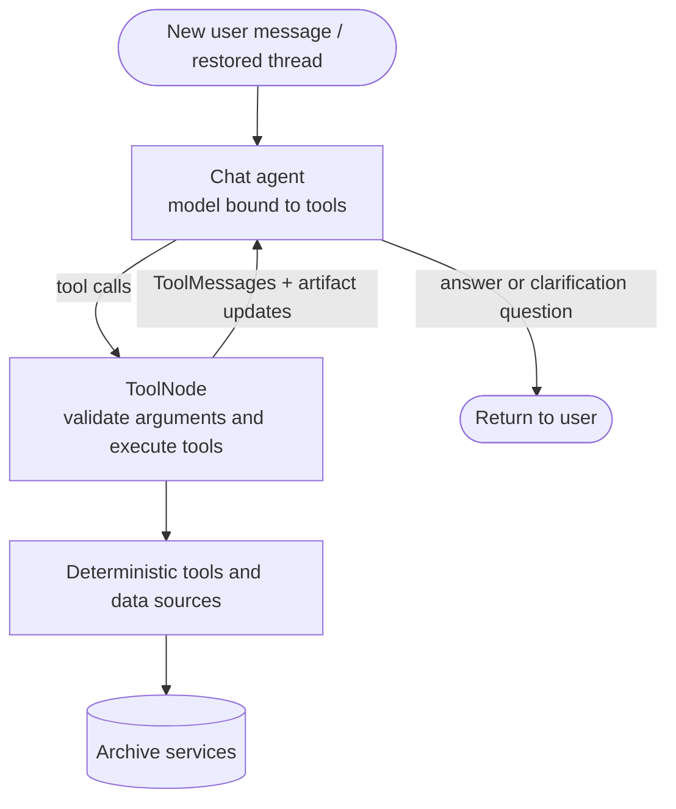

# SCOOP as a LangGraph chat application

## The boundary

The user talks to a chat agent. The model chooses typed tools; Python code
executes archive requests. There is no required intermediate natural-language
parser, and not every turn must produce a plan or a search.



A clarification is a normal assistant response ending this graph invocation;
when the user replies, invoke the same compiled graph with the same thread ID.
It is not a separate graph node or a fabricated archive result.

## Three kinds of state

1. **Messages** — human/assistant/tool conversation history, merged with
   LangGraph's message reducer. Tool responses are concise evidence summaries
   and result handles, not an entire catalog in the model context.
2. **Artifacts** — immutable, JSON-compatible tool result snapshots keyed by
   an opaque result ID. This is the first session inventory. Tools publish these
   with `Command(update=...)`; an ordinary returned dictionary is only a tool
   message, not an update to this state. Each parallel tool publishes only its
   own new artifact. The reducer rejects an attempt to overwrite an existing ID
   with different content; equal replay is allowed.
3. **External services and dependencies** — archive clients, model credentials,
   caches, download storage, and production databases live outside conversation
   state. Inject them when building tools/the graph. Never checkpoint clients or
   credentials in artifacts.

A result handle is not an astronomical object ID. A native `EntityRef` identifies
an archive entity; a result ID identifies one retrieval snapshot. Re-querying an
archive should create a new snapshot, not replace old evidence.

`QueryPlan` can describe an agent's proposed work, but it is neither a gate
before each tool call nor the source of authoritative results.

## Scientific tools

`scoop/server/app.py` builds the tool list for every turn, bound to the field and
layers the browser reports:

| Module | Tools |
| --- | --- |
| `chat/visual.py` | `load_field`, `describe_field`, `update_map`, `region`, `match`, `summarize`, `lookup` (SIMBAD), `overlaps`, `find_lvdb`, `run_field`, `run_cone`, `sky_image`, `add_data` |
| `chat/region_tools.py` | `find_stream`, `plan_region`, `run_region` (boxes, polygons, stream tracks) |
| `chat/data_agent.py` | `ask_data_agent`: a sub-agent with VizieR, registry/TAP and skill tools |
| `chat/pm_tools.py` | `pm_expectations`, `pm_published`, `pm_new_epoch`, `pm_wait_time`, `fit_members`, `auto_members` |
| `literature/tools.py` | `ads_search`, `ads_paper`, `ads_citations` (with an ADS token) |
| `chat/web_tools.py` | `web_search`, `web_fetch` |
| `chat/python_tool.py` | `run_python` (sandboxed Pyodide) |
| `chat/kernel_tool.py` | `run_kernel` (the user's own Jupyter kernel; off unless chosen in Settings) |

Tool schemas are action-specific rather than a single free-form `constraints`
argument. There is no unrestricted file-writing or download tool. A tool that
meets an expected service failure returns an error ToolMessage the agent can act
on, not an empty result; unexpected programming errors propagate from the
ToolNode so they are visible.

## Module layout

```text
scoop/
  models.py          # records, provenance, search status
  domain.py          # native entities and scientific assertions
  fields.py          # field tables, layers, filters, statistics
  spatial.py         # separations, footprints, regions
  sources/           # one module per data source (rows, query, presentation)
  lookup.py, resolve.py, images.py, lvdb.py   # SIMBAD, Sesame, sky cutouts, LVDB
  web.py             # web search (Exa) and page reading (Jina Reader, direct fetch)
  sandbox.py         # contained Python (Pyodide in Node, sandbox/runner.mjs) for run_python
  literature/        # ADS client and tools
  server/            # HTTP API, settings, background pipeline jobs
  kernel.py          # a Jupyter kernel in the user's environment, for run_kernel
  pm.py, members.py  # proper-motion planning and member fits
  regions.py, streams.py   # box/polygon/stream-track regions
  discovery.py       # VO registry, TAP and VizieR for the data agent
  cost.py            # token estimates, prices and per-conversation budgets
  scout/             # the monthly dataset scout
  chat/
    state.py         # messages and parallel-safe artifact reducer
    tools.py         # tool_error, and publish_result (a result + ToolMessage as one Command)
    prompt.py        # the workspace system prompt
    visual.py        # field, map, lookup and sky-image tools
    region_tools.py  # region planning and runs
    data_agent.py    # the data agent and its handoff tool
    pm_tools.py      # proper-motion tools
    web_tools.py     # web_search and web_fetch tools
    python_tool.py   # run_python on the field's tables
    kernel_tool.py   # run_kernel in the user's kernel
    graph.py         # injected model/tools, routing, checkpointer
    __init__.py      # optional chat API
```

Importing `scoop` does not import LangGraph. Install the chat extra separately:

```bash
pip install -e '.[chat]'
python3 -m unittest discover -s tests -v
```

Model-provider SDKs are deliberately not selected by this package. Supply an
initialized tool-calling model supporting `bind_tools` and `ainvoke`.

```python
from langgraph.checkpoint.memory import InMemorySaver
from scoop.chat import build_chat_graph

# model: initialized provider model; tools: actual application tool definitions.
# Keep this saver and graph alive across turns. InMemorySaver is not durable.
graph = build_chat_graph(model, tools, checkpointer=InMemorySaver())
config = {
    "configurable": {"thread_id": "conversation-123"},
    "recursion_limit": 24,
}
first = await graph.ainvoke(
    {"messages": [{"role": "user", "content": "Find spectra of M87"}]},
    config=config,
)
# Supply just the new message, not the complete previous state.
second = await graph.ainvoke(
    {"messages": [{"role": "user", "content": "Only HST, please"}]},
    config=config,
)
```

Thread IDs must be scoped to an authorized user/session by the host application;
LangGraph checkpointing is not an authentication boundary. Use a persistent
checkpointer for process restarts. Do not run concurrent turns on the same
thread without host-level coordination.

## What the scaffold proves, and what it does not

Offline tests use a scripted model and local tools, not fabricated live archive
responses. They exercise model-to-tool routing, artifact publication, parallel
result merges, checkpointed follow-ups, and thread isolation.

The system prompt asks the agent to cite source evidence and explain gaps, but
this is not a guarantee of faithful synthesis. Enforcing scientific claims
requires structured evidence links and evaluation (see `evaluation/`). Token
costs are estimated and budgeted per conversation (`scoop/cost.py`); there is
still no context compaction, inventory paging tool, durable artifact store, or
global archive concurrency limiter. Start with bounded results
and a recursion limit; large native tables/files should ultimately be stored
outside checkpoints and referenced by handle.

## References

- [LangGraph workflows and agents](https://docs.langchain.com/oss/python/langgraph/workflows-agents)
- [Graph API and MessagesState](https://docs.langchain.com/oss/python/langgraph/use-graph-api)
- [Tools: state updates and Command](https://docs.langchain.com/oss/python/langchain/tools)
- [Checkpointed conversation memory](https://docs.langchain.com/oss/python/langgraph/add-memory)
